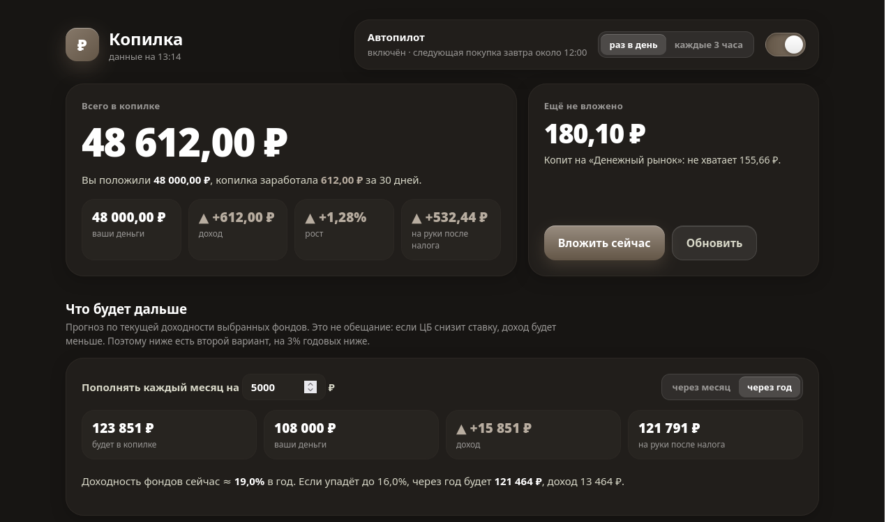
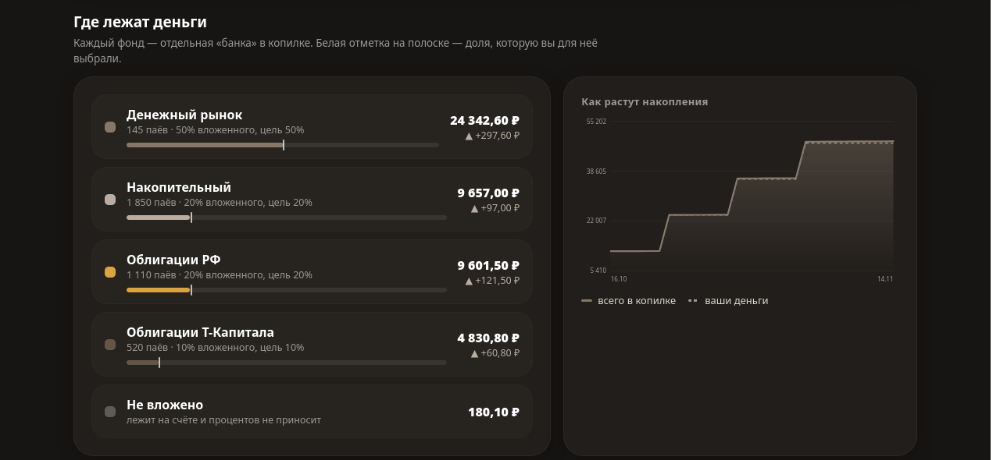
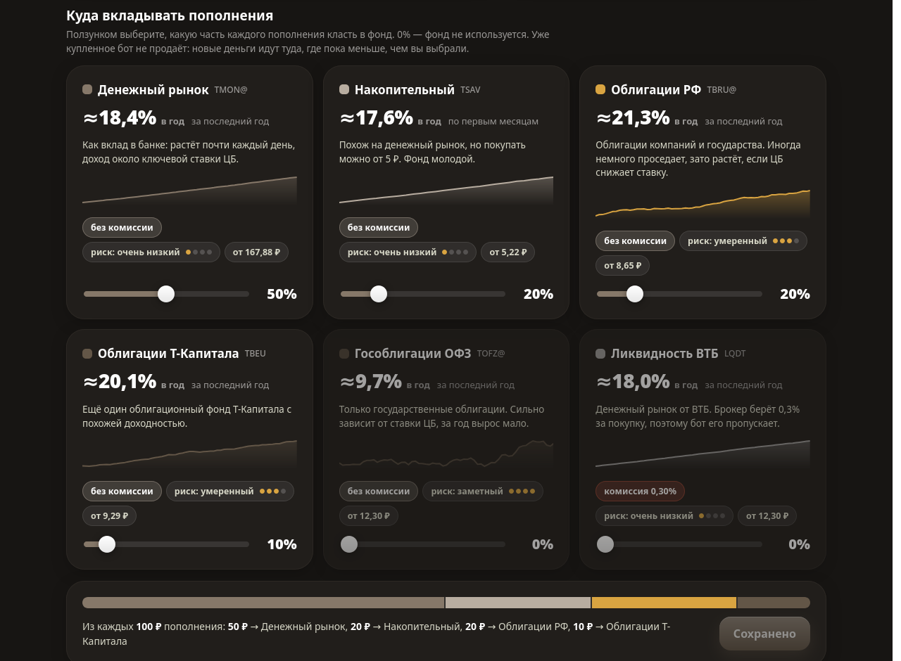

# 🐷 Kopilka: investing autopilot for zero-fee funds

A personal "piggy bank" for a brokerage account. It puts spare cash into **zero-commission money-market and bond funds** by the shares you choose, and shows everything on a local dashboard in plain language: how much you put in, how much the funds earned, what you'd get after tax, and a forecast.

> Screenshots use **demo data**.

## The story: from trading bot to accumulator

The project started as an automated trading bot that used an LLM to vet trade signals. Before risking real money, I backtested it:

- stocks: 4 months of intraday data and 3 years of daily data
- crypto: 9 years of data
- the LLM reviewer rejected every one of 150 historical signals, and each call cost money

**No variant beat the broker's commission.** Money-market funds, on the other hand, pay close to the central bank rate with zero fees. So the bot was rebuilt into an accumulator: boring, but it actually makes money.

## Features

- **Autopilot:** invests free cash once a day around 12:00 MSK, or no more than every 3 hours. If the laptop was off, it catches up at the next check.
- **Target shares:** new money goes to the funds that lag behind their target. It never sells what it bought. If a pricier fund's unit is almost affordable, it saves up for it.
- **Fee guard:** before every order it asks the broker for the order cost and skips the purchase if any commission appears.
- **Dashboard:** totals, income after 13% tax, 1-month and 1-year forecast with a pessimistic scenario, growth chart, per-fund cards with 1-year sparklines, risk level and sliders for target shares.
- **History:** every order and event is logged in SQLite.

  
  

## Engineering notes

- **Zero dependencies:** Python standard library only (`http.server`, `sqlite3`, `decimal`), REST calls to the T-Invest API, with TLS verified against the broker's CA certificates.
- **Security:** the panel listens on `127.0.0.1` only. Write requests need a per-start session key embedded in the page, plus `Origin`, `Host`, `Content-Type` and `Sec-Fetch` checks and a strict CSP.
- **Runs as a systemd user service** with a guard that keeps the laptop from sleeping while it works.
- **Theme follows the desktop wallpaper:** the dashboard reads the palette roles of the desktop theme.

## Source code

The code is private: it is a personal finance tool tied to a real brokerage account. If you need something similar, such as a broker or exchange API integration, a trading or investing dashboard, or backtesting, message me on Telegram: **[@LoXx_228](https://t.me/LoXx_228)**.

---

🇷🇺 <b>По-русски</b>

 

**Копилка** — автопилот для брокерского счёта в Т-Инвестициях. Раскладывает свободные деньги по фондам денежного рынка и облигаций без комиссии в заданных долях и показывает понятную статистику: сколько вложено, сколько заработано, сколько будет на руки после налога, прогноз на месяц и год.

Начиналось как торговый бот с ИИ-проверкой сигналов. Проверка на истории (акции за 3 года, крипта за 9 лет) показала, что ни одна стратегия не окупает комиссию брокера, и бот переделан в копилку.

Нужна интеграция с API брокера или биржи, дашборд или проверка стратегии на истории? Пишите: [@LoXx_228](https://t.me/LoXx_228).

